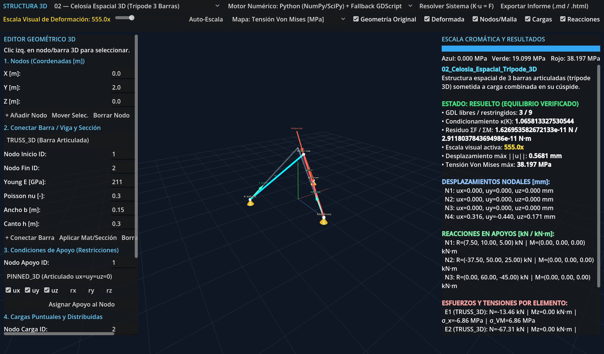
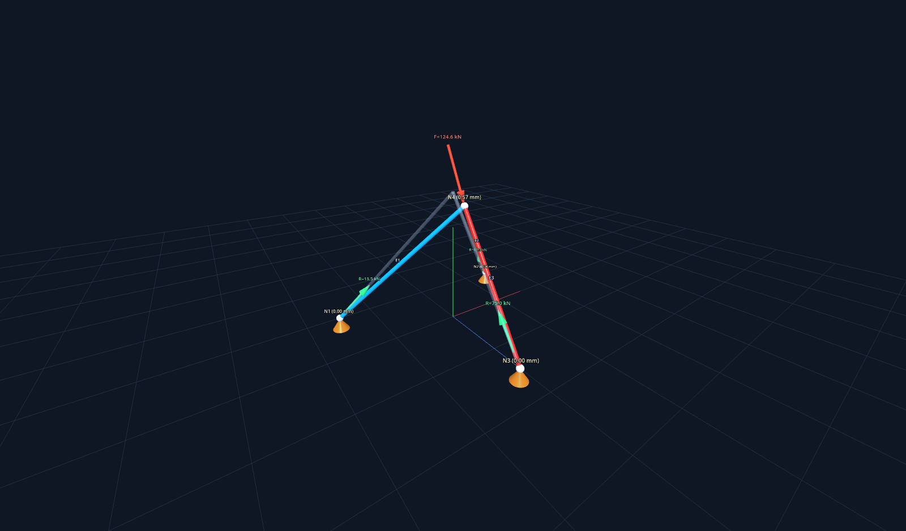
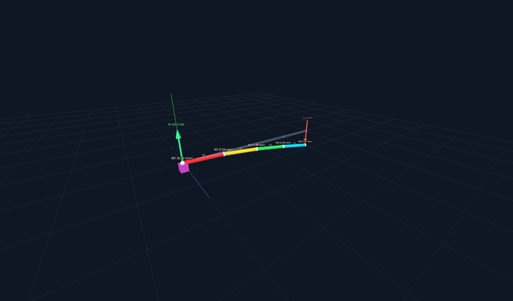
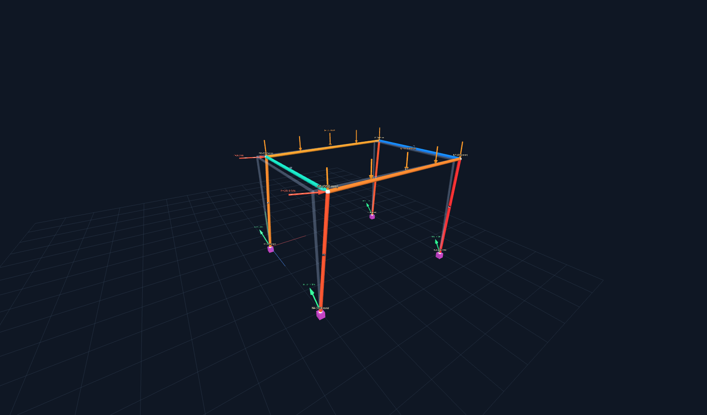
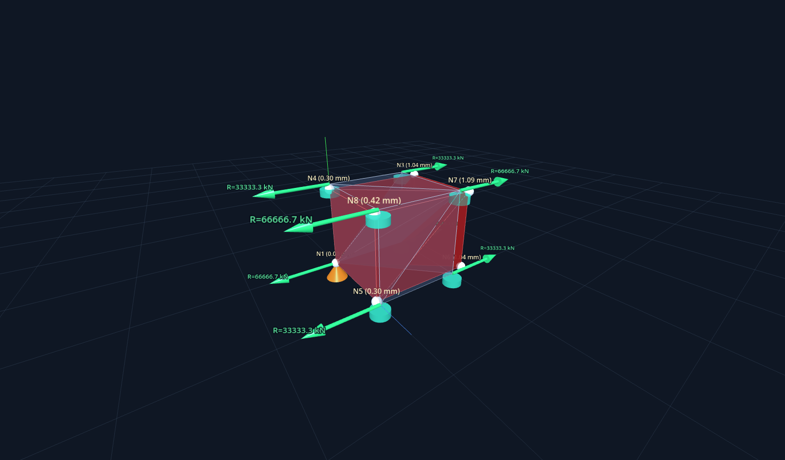

# Structura 3D — Entorno Interactivo de Análisis Estructural en 3D

> **ADVERTENCIA TÉCNICA:** Los resultados numéricos obtenidos mediante **Structura 3D** corresponden a un modelo elástico lineal e infinitesimal idealizado con fines exclusivamente académicos, educativos y conceptuales. **NO son aptos para construcción ni constituyen certificación estructural.**



---

## Galería de Casos Renderizados en 3D (Godot 4)

| Celosía Espacial 3D (`TRUSS_3D`) | Viga en Voladizo (`FRAME_3D`) |
| :---: | :---: |
|  |  |
| **Pórtico Espacial 3D (`FRAME_3D`)** | **Prisma Sólido Tetraédrico (`TETRA_4`)** |
|  |  |

---

## Estructura del Proyecto

- [`project.godot`](project.godot): Proyecto principal de **Godot 4** con interfaz 3D interactiva.
- [`scenes/Main.tscn`](scenes/Main.tscn): Escena 3D principal.
- `scripts/`:
  - [`scripts/MainController.gd`](scripts/MainController.gd): Editor geométrico 3D interactivo, selector de casos de referencia, control de escala visual de deformación, inspector de resultados y exportador de informes.
  - [`scripts/Visualizer3D.gd`](scripts/Visualizer3D.gd): Renderizado 3D de geometría original y deformada, numeración de nodos/elementos, apoyos, flechas de cargas/reacciones y mapas de color (Von Mises, desplazamientos y tensión axial).
  - [`scripts/OrbitCamera3D.gd`](scripts/OrbitCamera3D.gd): Cámara orbital 3D (clic derecho/central para orbitar, `Shift` + arrastrar para desplazar, rueda para zoom, `R` para centrar).
  - [`scripts/solver/SolverBridge.gd`](scripts/solver/SolverBridge.gd) y [`scripts/solver/NativeSolver.gd`](scripts/solver/NativeSolver.gd): Puente al motor numérico local en Python (`NumPy`/`SciPy`) y solucionador nativo en GDScript (100% sin IA en ejecución).
- `solver/`:
  - [`solver/model.py`](solver/model.py): Modelo de datos estructural y esquema `.structura.json`.
  - [`solver/elements.py`](solver/elements.py): Formulaciones matriciales 3D (`TRUSS_3D`, `FRAME_3D` Euler-Bernoulli, `TRIANGLE_3D` membrana CST de tensión plana y `TETRA_4` sólido tetraédrico).
  - [`solver/engine.py`](solver/engine.py): Solucionador por el Método de Rigidez Directa ($\mathbf{K}\cdot\mathbf{u}=\mathbf{F}$), detección de singularidad/mecanismos y verificación de equilibrio de fuerzas y momentos.
  - [`solver/benchmarks.py`](solver/benchmarks.py): 9 casos de referencia analíticos y de detección de fallos.
  - [`solver/report.py`](solver/report.py): Exportador de informes técnicos (`.md`, `.html`, `.result.json`).
  - [`solver/cli.py`](solver/cli.py): Interfaz de línea de comandos del motor numérico.
- [`tests/test_solver.py`](tests/test_solver.py) y [`tests/test_validation_gauntlet.py`](tests/test_validation_gauntlet.py): Suite de 23 pruebas automatizadas con `pytest`.
- `benchmarks/`: Archivos de malla `.structura.json` de todos los casos de referencia.
- `reports/`: Informes técnicos generados en Markdown, HTML, JSON y capturas 3D (`reports/renders/`).
- [`docs/DOCUMENTACION_TECNICA.md`](docs/DOCUMENTACION_TECNICA.md): Documentación matemática, hipótesis, limitaciones y modos de fallo no analizados.

---

## Ejecución Rápida

### 1. Ejecutar Pruebas Automatizadas
```powershell
py -m pytest -v
```

### 2. Resolver Todos los Casos de Referencia y Generar Informes
```powershell
py -m solver.cli --run-all-benchmarks
```

### 3. Resolver una Malla Específica desde CLI
```powershell
py -m solver.cli --input benchmarks/02_space_truss_3d.structura.json --report-dir reports
```

### 4. Abrir el Entorno 3D Interactivo en Godot 4
Ejecute `.\ejecutar_structura3d.bat` o abra `project.godot` desde **Godot Engine 4.x** y presione **F5 (Run Project)**.
